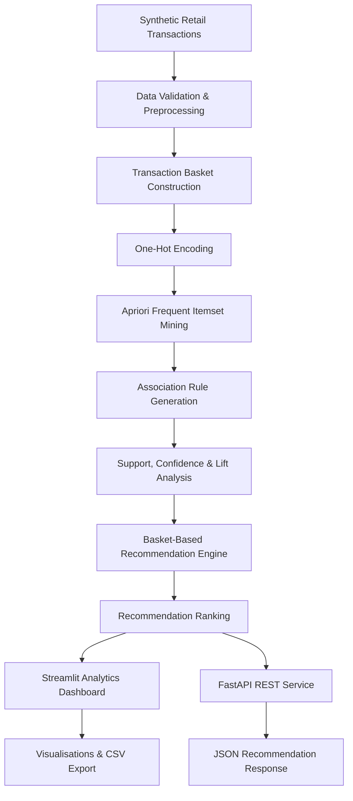

# Intelligent Market Basket Analysis and Product Recommendation Engine

An end-to-end retail analytics system designed to discover product associations, identify frequently purchased item combinations, and generate explainable cross-selling recommendations from transaction data. The platform integrates transaction preprocessing, frequent itemset mining, association rule generation, and basket-based product recommendations using the Apriori algorithm. It provides an interactive Streamlit dashboard and a FastAPI REST service for exploring purchasing patterns and recommendation insights.

> **Data Notice:** The included transaction dataset is synthetically generated for demonstration and testing. It does not represent real customers, retailers, or actual purchasing behaviour. Recommendations are based on statistical associations, not causal relationships or guaranteed sales improvements.

## Key Features

- **Synthetic Transaction Generation:** Creates reproducible retail transaction datasets for market basket analysis.
- **Transaction Preprocessing:** Cleans transaction records and transforms line-item data into structured product baskets.
- **Frequent Itemset Mining:** Implements the Apriori algorithm to discover frequently occurring product combinations.
- **Association Rule Generation:** Identifies product relationships using support, confidence, and lift.
- **Basket-Based Recommendations:** Suggests relevant products based on items already present in a shopping basket.
- **Recommendation Ranking:** Ranks candidate products using association-rule metrics.
- **Retail Analytics Dashboard:** Visualises frequent itemsets, association rules, product relationships, and recommendation results.
- **REST API Integration:** Provides endpoints for association analysis and product recommendations through FastAPI.
- **Reproducible Experiments:** Includes synthetic data generation, exploratory analysis, unit tests, and methodology documentation.

## System Architecture



## Core Analytical Modules

### 1. Transaction Data Generation and Preprocessing

Prepares transaction-level data for association-rule mining.

- Synthetic retail transaction generation
- Transaction and product identifier validation
- Duplicate record handling
- Missing-value checks
- Product basket construction
- Transaction-to-product matrix transformation
- One-hot encoding of product presence

Each transaction is represented as a basket containing the products purchased together.

### 2. Frequent Itemset Mining

Uses the Apriori algorithm to identify product combinations that occur frequently across transactions.

**Algorithm:** Apriori

The process:

1. Identifies frequent individual products.
2. Generates candidate combinations of increasing itemset sizes.
3. Calculates transaction support for each candidate.
4. Removes combinations that do not satisfy the minimum support threshold.
5. Retains frequent itemsets for association-rule generation.

This helps uncover recurring product combinations and purchasing patterns.

### 3. Association Rule Mining

Generates directional rules from frequent itemsets to understand relationships between products.

For example:

`{Bread, Butter} → {Jam}`

This indicates that transactions containing bread and butter are associated with transactions containing jam in the analysed dataset.

**Key evaluation metrics:**

| Metric | Definition | Interpretation |
|---|---|---|
| Support | Proportion of transactions containing an itemset | Measures how frequently an item combination occurs |
| Confidence | Support of antecedent and consequent divided by support of antecedent | Measures how often the consequent appears when the antecedent occurs |
| Lift | Confidence divided by support of consequent | Measures association strength relative to the consequent's baseline frequency |

**Mathematical Formulations**

Support:

\[
Support(A \cup B) =
\frac{\text{Transactions containing A and B}}
{\text{Total transactions}}
\]

Confidence:

\[
Confidence(A \rightarrow B) =
\frac{Support(A \cup B)}{Support(A)}
\]

Lift:

\[
Lift(A \rightarrow B) =
\frac{Confidence(A \rightarrow B)}{Support(B)}
\]

**Lift interpretation:**

- Lift greater than 1: Positive association.
- Lift equal to 1: No association beyond the baseline expectation.
- Lift less than 1: Negative association.

A high lift value should also be considered alongside support and confidence. Rare combinations can produce high lift values without being commercially significant.

### 4. Basket-Based Product Recommendation Engine

Transforms association rules into product recommendations based on the products already present in a shopping basket.

**Recommendation workflow:**

1. Accept the products in the current basket.
2. Match the basket against association-rule antecedents.
3. Identify matching rules.
4. Extract consequent products not already present in the basket.
5. Rank candidate products using confidence and lift.
6. Return the recommended products with supporting rule metrics.

**Example:**

| Current Basket | Associated Product | Recommendation Basis |
|---|---|---|
| Bread, Butter | Jam | Association rule |
| Milk, Cereal | Bananas | Association rule |
| Pasta, Sauce | Cheese | Association rule |

*Illustrative examples only; actual recommendations depend on the generated dataset and discovered rules.*

### 5. Interactive Retail Analytics Dashboard

The Streamlit dashboard provides an interface for exploring product relationships and recommendation results.

- Total transaction and product KPIs
- Frequent itemset analysis
- Top association rules
- Support, confidence, and lift visualisations
- Product combination exploration
- Basket-based product recommendations
- Interactive filters and threshold selection
- Downloadable CSV reports

## Technology Stack

| Category | Technologies |
|---|---|
| Programming Language | Python |
| Data Processing | Pandas, NumPy |
| Association Rule Mining | Mlxtend |
| Algorithm | Apriori |
| Recommendation Logic | Association Rule-Based Ranking |
| Data Visualisation | Matplotlib, Plotly |
| Dashboard | Streamlit |
| Backend API | FastAPI, Uvicorn |
| Data Format | CSV, JSON |
| Testing | Pytest |
| Development Environment | Jupyter Notebook, VS Code |
| Version Control | Git, GitHub |

## Quick Start

### Prerequisites

- Python 3.10 or later
- pip package manager
- Git (optional)

### 1. Clone the Repository

```bash id="9m3qvk"
git clone <repository-url>
cd <repository-folder>
```

### 2. Create a Virtual Environment

```bash id="2v8n4c"
python -m venv venv
```

**Windows:**
```bash id="6p3j8w"
venv\Scripts\activate
```

**macOS / Linux:**
```bash id="4x7q2m"
source venv/bin/activate
```

### 3. Install Dependencies

```bash id="8c5n1r"
pip install -r requirements.txt
```

### 4. Generate the Synthetic Transaction Dataset

```bash id="3w9k6p"
python scripts/generate_data.py
```

### 5. Launch the Streamlit Dashboard

```bash id="5h2m7q"
streamlit run app/streamlit_app.py
```

Open the local URL displayed in the terminal to access the interactive analytics dashboard.

> **Note:** The commands above assume the example script and application paths exist in the repository. Adjust them to match the actual implementation.

## FastAPI Integration

The project provides a lightweight REST API for accessing association-rule analysis and product recommendation functionality.

### Start the API Server

```bash id="7n4x2v"
uvicorn api.main:app --reload
```

### Access Interactive API Documentation

Open Swagger UI:

```text id="1q8m5z"
http://127.0.0.1:8000/docs
```

### API Endpoints

| Endpoint | Method | Purpose |
|---|---|---|
| `/health` | GET | Checks API availability |
| `/recommend` | POST | Generates basket-based product recommendations |
| `/rules` | GET | Retrieves discovered association rules |

*The endpoint names and methods should match the actual FastAPI implementation.*

### Example Recommendation Input

```json id="6r2p9w"
{
  "basket": [
    "Bread",
    "Butter"
  ]
}
```

The API can return matching recommendations along with supporting association-rule metrics such as confidence, support, and lift.

*Illustrative request format only. Actual product names and JSON schemas depend on the implementation.*

## Project Structure

```text id="4m8x1q"
Market_Basket_Analysis/
│
├── api/
│   └── main.py                  # FastAPI application
│
├── app/
│   └── streamlit_app.py         # Interactive dashboard
│
├── data/
│   └── synthetic_transactions.csv
│
├── docs/
│   ├── methodology.md           # Analytical methodology
│   └── api_documentation.md     # API documentation
│
├── notebooks/
│   └── exploratory_analysis.ipynb
│
├── scripts/
│   └── generate_data.py         # Synthetic transaction generation
│
├── market_basket/
│   ├── preprocessing.py          # Transaction preprocessing
│   ├── itemsets.py               # Apriori implementation
│   ├── association_rules.py      # Rule generation
│   └── recommender.py            # Product recommendation logic
│
├── tests/                        # Unit tests
│
├── requirements.txt
└── README.md
```

*This is a suggested repository layout. Retain the actual filenames and modules implemented in your project.*

## Evaluation and Analytical Considerations

The quality of discovered associations and recommendations can be examined through:

- **Minimum Support:** Controls how frequently an itemset must occur to be considered.
- **Minimum Confidence:** Filters rules based on conditional co-occurrence frequency.
- **Lift:** Helps identify associations beyond the consequent's baseline popularity.
- **Rule Coverage:** Measures how many transactions or baskets can be matched by discovered rules.
- **Recommendation Coverage:** Measures the proportion of baskets for which recommendations can be generated.
- **Ranking Evaluation:** Precision@K, Recall@K, and NDCG@K can be used when suitable held-out interaction data and relevance labels are available.

For a meaningful evaluation, transaction data should be separated chronologically where appropriate, and recommendation performance should be compared against simple popularity-based baselines.

## Limitations

- The bundled transaction dataset is synthetic and does not represent real retail purchasing behaviour.
- Association rules identify co-occurrence patterns rather than causal relationships.
- Product popularity can influence support, confidence, and lift.
- Seasonality, discounts, promotions, and stock availability are not necessarily represented.
- Recommendations depend on the minimum support and confidence thresholds.
- Apriori can become computationally expensive when transaction volumes and product combinations grow significantly.
- Offline association metrics do not guarantee increased revenue, conversion, or customer satisfaction.

## Responsible Data Use

- Use synthetic or properly authorised transaction data.
- Protect customer information and avoid unnecessary personal data collection.
- Apply appropriate anonymisation and access controls when processing real transaction records.
- Do not interpret association rules as proof of customer preferences or purchasing intent.
- Validate recommendations using suitable offline evaluations and controlled experiments before business adoption.
- Consider inventory availability, product relevance, and customer experience when applying recommendations.

## Future Enhancements

- FP-Growth for more efficient frequent itemset mining
- Advanced recommendation ranking strategies
- Collaborative filtering and hybrid recommendation systems
- Product category and customer-segment association analysis
- Time-aware and seasonal market basket analysis
- Personalised recommendation experiments using authorised data
- Inventory-aware product recommendations
- Recommendation performance monitoring
- Scalable processing with distributed analytics frameworks
- Docker-based deployment and cloud integration

## Author

**Mohamed Riyaz S.**  
Integrated M.Tech – Computer Science and Engineering (Business Analytics)  
Vellore Institute of Technology (VIT), Chennai
